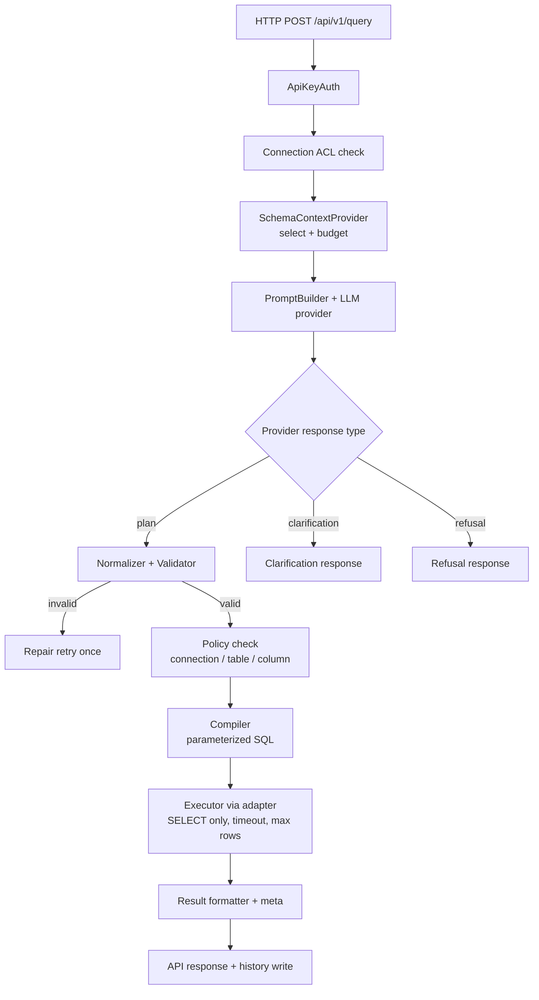
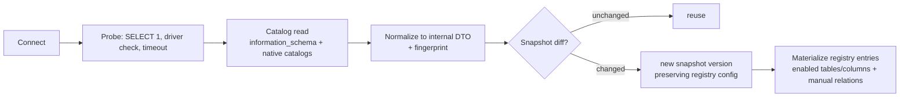

# QueryLayer — Technical Implementation Plan

**Status:** Draft — awaiting owner approval before any implementation
**Source:** Derived from PRODUCT_BRIEF.md (§17–19 instructions)
**Related docs to split out on approval:** PRODUCT, ARCHITECTURE, TECHNICAL_DECISIONS, API_SPECIFICATION, SECURITY, DEVELOPMENT_ROADMAP, TESTING_STRATEGY, OPEN_QUESTIONS

**Legend:** `[ASSUMED]` = engineering judgment, not verified. `[VERIFY]` = must be checked against current official docs before implementation. Facts without tags reflect stable platform capabilities (SQL, information_schema standards).

---

## 0. Summary of Architectural Challenges (per Brief Step 3)

### D1. Relational filter semantics — the hardest problem, resolved in the IR grammar

**Problem.** The brief's example plan filters `orders.created_at` while querying `customers`. That notation is underspecified: join vs. correlated subquery, semantics when a customer has many orders, aggregate collapse behavior. This is where NL-to-SQL systems silently produce wrong results.

**Decision (recommended).** The IR **does not allow cross-entity field references** in filters. Instead, related predicates are a closed grammar:

- Filter scope A: own-column filters (`{"field": "created_at", ...}` on the root entity only) — v1.
- Filter scope B: existence filters `{"op": "exists" | "not_exists", "relationship": "orders", "filter": {own-column filters on orders}}` — grammar defined in v1, compiled in M2/M3 as correlated `EXISTS`/`NOT EXISTS` subqueries.
- Aggregate-in-filter ("customers with revenue > $100") — **explicitly out of scope for v1**, added later as `exists` + `having` variant only after correctness testing.

This makes the grammar small, compileable, and testable, and eliminates the largest class of hallucinated joins.

### D2. Laravel for the shell only; engine core is framework-agnostic PHP

Laravel is a good fit for: HTTP/API, auth middleware, encryption at rest, migrations, queue abstraction, admin console routing. It is the wrong place for:

- **IR definitions and validators** — must be testable in isolation and portable.
- **SQL compilers** — Laravel Query Builder has raw-SQL escape hatches and is a poor fit for anti-joins and conditional aggregates (it can do them, but awkwardly and with pipeline ceremony).

**Decision (recommended).** QueryEngine (IR, schema registry, validator, compilers, adapter contracts) lives in a `packages/querylayer-engine` style namespace composed as plain PHP classes registered in Laravel's container. Compilers emit **parameterized SQL directly** from the closed IR (preferred), with Query Builder as an acceptable fallback if velocity demands. Fully listed in Open Decisions (O2).

### D3. Drop Redis from the MVP

Synchronous request/response product; no queue workload in MVP; rate limiting in v1 can be token-bucket at app level (DB-backed or in-memory). Redis/PDO complications (deployment surface, another password to store) hurt the "easy self-host" story.

**Decision (recommended).** PostgreSQL is the only backing state store for QueryLayer itself. Revisit Redis at Phase 4 if rate limiting/audit volume demands it.

### D4. Planner protocol is a discriminated union, not "always a plan"

`LlmProviderInterface::plan()` returns one of:

```text
{ "type": "plan",           "plan": { ...IR... }, }
{ "type": "clarification",  "questions": [ { "id", "question", "options[]" } ] }
{ "type": "refusal",        "reason": "out_of_scope|unsafe|unsupported" }
```

This makes the brief's §12.2 (ambiguity) an implementable contract. Backend may respond to clarification via a follow-up `POST /api/v1/query` with `clarification_answers` attached; v1 fallback is returning clarification options to the API caller unchanged.

### D5. Never trust provider structured-output enforcement alone

Providers' JSON-schema enforcement (OpenAI structured outputs [VERIFY current scope], Anthropic tool-use/JSON schema [VERIFY]) is enforced at the network boundary. QueryLayer applies its **own validator** on top; malformed or schema-passing-but-semantically-invalid plans go through **one repair retry** with validator errors fed back, then a structured `PLAN_COMPILE_FAILED` error. No silent fallback to "best effort".

### D6. The quality investment is the golden plan test suite

Correctness (brief §12.4) is measurable only if we compare *plans*, not SQL strings, against hand-authored golden cases. IR JSON is deterministic and diffable. The eval suite (seeded Postgres + MySQL e-commerce fixtures, ~50 cases in M3 growing to ~150 in M5) is the primary regression mechanism — this gets built with the engine, not after it.

### D7. Schema ingestion path decision

Introspection reads `information_schema` for portable basics (tables, columns, keys, FKS) and uses native catalogs for speed/depth (`pg_catalog`, `INFORMATION_SCHEMA.STATISTICS` / MySQL 8 data dictionary [VERIFY for MySQL 8 exact views]). FKS are **hints only** — confidence ≤ "inferred" — never auto-trusted as real relationships (brief §12.1 satisfied). Manual relationships live in the registry and win over inferred ones.

### D8. Explicit limitation: QueryLayer cannot *enforce* read-only DB users

QueryLayer can strongly recommend and posture-check (prescriptive doc, connection test that attempts a no-op write in a transaction+rollback and warns if it succeeds), but the guarantee ultimately rests on DB user grants. This is documented as a hard product limitation in SECURITY doc, not papered over. Query execution itself is read-only by construction (compiler emits only `SELECT`).

---

## 1. Recommended Technology Stack

| Concern | Choice | Rationale |
|---|---|---|
| Application shell | Laravel 13 (confirmed by owner; [VERIFY PHP floor before scaffold]) | Maturity, encryption, auth, migrations, admin console |
| QueryEngine | Plain PHP classes behind interfaces (no ORM dependency) | Testability, portability (D2) |
| QueryLayer's own state store | PostgreSQL | Rich JSONB for snapshots/plans; one backing service |
| External DBs (target) | PostgreSQL first, then MySQL (MariaDB compat check) | pg catalogs richer, safer introspection ground truth |
| SQL generation | Custom parameterized compiler over closed IR | Closed grammar → auditable generator; no raw-string paths (D2) |
| LLM providers | OpenAI, Anthropic, OpenAI-compatible v1 (Gemini v1.x) — via own thin adapter layer | BYOK, no provider SDK lock-in; provider SDKs evaluated per-provider only if needed [VERIFY each] |
| Frontend | **Decided in O1**: Blade + Alpine (minimal) vs React (brief preference) | Brief prefers React; recommended default is Blade-first if owner has no strong preference |
| Deployment | Docker Compose: `app` + `postgres` + optional `web` (nginx) or built-in artisan server for dev | Single-command self-host |
| API docs | OpenAPI 3.1 generated/served | Brief requirement |
| Cache | Database-backed (or filesystem) — *no Redis in MVP* | D3 |
| Tests | PHPUnit/Pest; golden IR suites; docker-compose test profile with real PG/MySQL services | D6 |

---

## 2. Product Architecture

### 2.1 Module map

```text
QueryLayer
├── app (Laravel)
│   ├── Http/Api (connect, query, schema, history endpoints)
│   ├── Http/Dashboard (blade or react-backed routes)
│   ├── Models (Eloquent ONLY for QueryLayer's own tables)
│   ├── Jobs (provider retries, schema refresh, if needed later)
│   └── Support (crypto, api key hashing, settings)
│
├── packages/engine (framework-agnostic; no Illuminate dependency in core)
│   ├── ir/            (plan DTOs, versioned schema, parser/normalizer)
│   ├── schema/        (registry DTOs, introspection contracts)
│   ├── validation/    (validator + error taxonomy)
│   ├── compile/       (per-dialect emitters: pg, mysql)
│   ├── execute/       (adapter contracts, executor, result shaping)
│   └── context/       (schema-context provider contract + strategies)
│
├── integrations/
│   ├── db/            (pdo adapters: PgAdapter, MysqlAdapter; introspectors)
│   └── llm/           (OpenAiProvider, AnthropicProvider, OpenAiCompatProvider)
│
└── dashboard/
    └── (views + api layer per O1)
```

### 2.2 Request flow



### 2.3 Component responsibility boundaries

| Component | Owns | Explicitly does NOT know about |
|---|---|--- |
| SchemaRegistry | canonical, versioned enabled-schemas | LLM, SQL, HTTP |
| SchemaContextProvider | what to include in LLM context given token budget | parsing responses |
| LlmProvider | provider I/O, retries, schema enforcement quirks | validation, DB |
| Normalizer | LLM output → IR types | re-prompting |
| Validator | semantic validity against registry; policy precheck | execution |
| Compiler | IR → dialect-specific parameterized SQL + params list | policy, LLM |
| Executor | timeouts, max rows, adapter lifecycles | LLM, policy |
| ApiKeys/Auth | who may call | data filtering |
| PolicyGuard | per-connection/per-table/per-column grants for the caller | SQL |

---

## 3. QueryLayer's Own Database Schema (Postgres)

```sql
connections (
  id uuid pk, name text unique, driver text CHECK in ('postgres','mysql'),
  host text, port int, database_name text, username text,
  password_ciphertext text,       -- libsodium sealed via APP_KEY-derived key [VERIFY Laravel Crypt]
  ssl_mode text, options jsonb,
  read_only_verified_at timestamptz, status text, created_at, updated_at, deleted_at
)

schema_snapshots (
  id uuid pk, connection_id fk, version int, captured_at timestamptz,
  fingerprint text,               -- used for change detection (§12.3)
  raw_json jsonb                  -- full normalized introspection output
)

schema_registry_entries (
  connection_id fk, snapshot_version int, entity_name text,
  enabled bool, description text, metadata jsonb,
  primary key (connection_id, snapshot_version, entity_name)
)
schema_registry_columns (
  connection_id, snapshot_version, entity_name, column_name,
  enabled bool, description text,
  primary key (connection_id, snapshot_version, entity_name, column_name)
)
schema_registry_relationships (
  connection_id, snapshot_version, id uuid, from_entity, from_column, to_entity, to_column,
  origin text CHECK in ('inferred','manual'), enabled bool, description text,
  primary key (connection_id, snapshot_version, id)
)

api_keys (
  id uuid pk, name text, key_prefix text,        -- prefix shown in UI (e.g. "ql_9f3...")
  key_hash text unique,                          -- sha-256(raw key); raw shown once at creation
  scopes jsonb, created_at, last_used_at, revoked_at
)

query_history (
  id uuid pk, api_key_id fk null, connection_id fk,
  prompt text, clarification_answers jsonb null,
  llm_response jsonb,                    -- selected provider response for audit
  request_id text, status text,
  error_code text null, error_detail jsonb null,
  llm_input_tokens int null, llm_output_tokens int null,
  llm_duration_ms int null, db_duration_ms int null,
  returned_row_count int, created_at
)
-- Result ROWS are intentionally NEVER persisted here.

settings (key text pk, value jsonb, updated_at)
audit_log (id uuid, actor_type, actor_id, action, subject_type, subject_id, ip, meta jsonb, created_at)
```

Notes:

- Soft-delete on `connections` to avoid accidental destructive ops.
- `schema_registry_*` keyed by snapshot version so old plan records remain interpretable (§12.3 / history readability).
- Eloquent used **only** for these tables — never for external database access.

---

## 4. Intermediate Query Representation — IR v1

### 4.1 Grammar (target schema)

```jsonc
{
  "version": 1,
  "entity": "customers",                       // one root entity only in v1
  "operation": "select",                       // "select" v1; "aggregate" grammar below accepted in v1 but compiled in M3
  "columns": [ { "name": "id" }, { "name": "email" } ],

  "filters": {
    "logic": "and",                            // "and" in v1; "or" accepted but compiled only when safe
    "conditions": [
      { "field": "created_at", "operator": "gte",
        "value": { "type": "datetime", "value": "2026-10-01T00:00:00Z" } },

      { "scope": "exists", "relationship": "orders",
        "filter": { "logic": "and", "conditions": [
            { "field": "total_amount", "operator": "gt",
              "value": { "type": "decimal", "value": 100 } } ] } }
    ]
  },

  "sort":   [ { "column": "created_at", "direction": "desc" } ],
  "limit":  10,
  "offset": 0
}
```

Aggregate operation shape (compiled from M3 onwards, present in grammar from v1 to avoid schema churn):

```jsonc
{
  "operation": "aggregate",
  "entity": "products",
  "select": [
    { "name": "name" },
    { "aggregate": "count", "alias": "orders_count" },
    { "aggregate": "sum",   "field": "total_amount", "alias": "revenue" }
  ],
  "group_by": [ { "name": "name" } ],
  "having":   { /* mirrors filter grammar over aggregate aliases or fields */ },
  "order_by": [ { "sort_by": "alias", "value": "revenue", "direction": "desc" } ],
  "limit": 10
}
```

### 4.2 Rules

- `field`/`column` names are **bare names on the root entity** — never `table.column` dotted strings. Cross-entity access is only via `exists`/aggregate grammar. This closes D1.
- LLM receives entities by their registry names, not real table names, so hallucinated joins structurally cannot reference non-enabled entities.
- Every filter `value` is transported as a parameter, never inlined by the compiler.
- Plan schema itself is **versioned**; unknown `version` rejected up front with `UNSUPPORTED_PLAN_VERSION`.
- Always `SELECT`-only. No mutation verbs exist in the grammar, so they can't be generated.

### 4.3 Explicitly not in v1

- `OR` across scopes (only `AND` compiled in v1; `OR` accepted, validated, rejected with `UNSUPPORTED_IN_V1` if reached, to be enabled after testing).
- Nested `exists` >1 level deep.
- Aggregate-in-filter.
- Subqueries in sort/having.
- `union`, CTEs, window functions — permanent non-goals unless a validated use case appears.

---

## 5. Schema Registry & Introspection

### 5.1 Introspection pipeline



### 5.2 Semantics

- **Fingerprint** = cheap hash over `information_schema.tables/columns` + pg MySQL catalogs to detect drift (§12.3) — refreshed on demand and every N hours [VERIFY cron cadence]; stale snapshot forces refresh before planning.
- FKS are stored as `origin: inferred` and surfaced to the LLM explicitly labeled "inferred". Manual relationships override by identity.
- Column-level type mapping to a small fixed set: `bool | int | decimal | string | text | date | datetime | uuid | json | enum(domain) | blob | unknown`. `unknown` is allowed to plan against but compiles with a runtime type check warning.

---

## 6. LLM Provider Abstraction

```php
interface LlmProviderInterface {
    /** @return PlanResponse|ClarificationResponse|RefusalResponse */
    public function plan(QueryContext $context): PlannerResponse;

    /** @return PlanResponse — used for the single repair retry */
    public function repairPlan(QueryContext $context, array $validatorErrors): PlannerResponse;

    public function usage(): TokenUsage;
    public function model(): string;
}
```

Prompt structure (versioned `prompt_id` stored in history):

1. `system:` role, IR grammar reference (compact JSON schema), entity/relationship catalog from `SchemaContextProvider`, trusted `{now: <UTC+tz>}`.
2. `user:` user prompt + effective allowed-operator list.
3. Provider-native structured-output enforcement `[VERIFY per provider]` + our parser/normalizer on top (D5).

`SchemaContextProvider` strategies:

- `full` (default when enabled entity-count is under a token budget, e.g. 6k tokens [ASSUMED threshold]),
- `targeted` (top-K entities by name/description similarity for v1; embedding retrieval later).

Rows are **never** sent; only schema metadata + user-provided descriptions. Documented LLM data-outflow banner in dashboard (brief §11).

Providers: `OpenAiProvider`, `AnthropicProvider`, `OpenAiCompatibleProvider` in v1; `GeminiProvider` accepted if BYOK demand arrives; `OllamaProvider`(OpenAI-compat path) — evaluated in Phase 5 (local LLM), not a v1 requirement.

---

## 7. Validation Pipeline

Stages, in order; first failure short-circuits with structured error:

1. Schema validation (`version` exists, all required keys, correct types).
2. Registry validation (entity exists; entity enabled).
3. Field validation (each selected column exists and is enabled).
4. Filter validation (operator in allowed set per column type; relationship exists & enabled; nested filter ≤ depth 1).
5. Aggregation validation (aggregate functions allowed; group/having consistency).
6. Limits (`MAX_LIMIT` config, default 1000; `MAX_OFFSET`; sort column selectable).
7. Policy (per-API-key grants: connection, entity, column — default-deny).
8. Cost preflight (`LIMIT` present, or reject with `LIMIT_REQUIRED`; [VERIFY-optional] `EXPLAIN` cost cap on Postgres, skipped on MySQL v1 if EXPLAIN semantics diverge).

Repair loop: on failures 1–4, provider may be invoked once via `repairPlan` with the validator error list; a second failure terminates the request as `PLAN_REJECTED` (never executes). Failures 5–8 are terminal — they represent policy or grammar limits, not model mistakes.

---

## 8. Execution & Adapters

```php
interface DatabaseAdapterInterface {
    public function introspect(): SchemaSnapshotDto;
    public function health(): HealthCheckDto;
    public function readVersion(): string;
    public function compile(Plan $plan): CompiledQuery;   // provided by Compiler → adapter binds to session
    public function execute(CompiledQuery $q, ExecutionLimits $l): ResultSet;
}
```

Concrete: `PostgresAdapter`, `MySqlAdapter`. Both are PDO-backed; connections built per request with `PDO::ATTR_TIMEOUT` / statement timeout (PG `SET statement_timeout`, MySQL `max_execution_time` [VERIFY server-side support]) plus app-level driver timeout.

Guarantees:

- Every filter/sort/group value is parameterized. No identifier strings ever come from user/LLM text — only from v1 registry names (validated against `^[a-zA-Z_][a-zA-Z0-9_]*$` plus allowlist membership), then quoted per dialect.
- Temp read-only enforcement per session where supported (PG: `SET default_transaction_read_only = on` [VERIFY]); belt-and-braces to the advisory user-grants posture check (D7/D8).
- `ExecutionLimits`: `max_rows` (default 1000), `statement_timeout_ms` (default 15000), `max_plan_cache_age`, `max_results_bytes` (reject over-size before JSON encode).

---

## 9. API Contracts (summary; full doc = API_SPECIFICATION later)

| Method | Path | Notes |
|---|---|---|
| POST | `/api/v1/connections` | create (password accepted once in body, never returned) |
| GET | `/api/v1/connections` | list w/o secrets |
| PATCH | `/api/v1/connections/{id}` | update credentials/options |
| POST | `/api/v1/connections/{id}/test` | health + advisory read-only probe |
| GET | `/api/v1/connections/{id}/schema` | current snapshot + registry |
| POST | `/api/v1/connections/{id}/schema/refresh` | force re-introspect; triggers fingerprint diff |
| POST | `/api/v1/query` | NL query; see below |
| GET | `/api/v1/queries` | history (no result rows) |
| GET | `/api/v1/health` | |
| GET | `/api/v1/openapi.json` | |

### 9.1 Successful query

```json
// POST /api/v1/query
{
  "success": true,
  "data": [ { "id": 101, "email": "x@y.com" } ],
  "meta": {
    "request_id": "req_...",
    "returned_records": 1,
    "execution_ms": 42,
    "llm": { "provider": "openai", "model": "…", "input_tokens": 812, "output_tokens": 173 },
    "plan": { "version": 1, "entity": "customers", "operation": "select", "columns": ["id","email"] }
  }
}
```

### 9.2 Clarification response

```json
{
  "success": false,
  "clarification_required": true,
  "questions": [
    {
      "id": "q1",
      "question": "Which 'latest' do you mean?",
      "options": [
        { "id": "registered_at", "label": "Newest registrations (created_at)" },
        { "id": "last_order",    "label": "Most recent orders (orders.created_at)" }
      ]
    }
  ],
  "meta": { "request_id": "req_..." }
}
```

### 9.3 Error response

```json
{
  "success": false,
  "error": {
    "code": "FIELD_NOT_ALLOWED",
    "message": "Column 'ssn' exists but is not enabled for queries.",
    "request_id": "req_...",
    "details": { "field": "ssn", "entity": "customers" }
  }
}
```

Canonical error codes: `UNAUTHORIZED`, `RATE_LIMITED`, `CONNECTION_NOT_FOUND`, `CONNECTION_UNHEALTHY`, `PLAN_REJECTED`, `SCHEMA_ENTRY_NOT_FOUND`, `FIELD_NOT_ALLOWED`, `RELATIONSHIP_NOT_ALLOWED`, `UNSUPPORTED_OPERATION`, `UNSUPPORTED_PLAN_VERSION`, `LIMIT_REQUIRED`, `QUERY_TIMEOUT`, `RESULT_TOO_LARGE`, `PROVIDER_ERROR`, `INTERNAL_ERROR`. Error messages never include SQL, connection strings, or provider `request-id`s verbatim — mapped only to sanitized detail.

---

## 10. Auth & Access Control

- API keys: `ql_…` prefixed, stored only as sha-256 hash + prefix fragment. Shown once at creation.
- v1: single workspace; a key has `scopes = {connections: [...], max_rows: n, allow_aggregates: bool}`. Schema already supports multi-tenant PCA pattern [ASSUMED] to add teams later without migration.
- Dashboard authLaravel session (guarded routes); never interacts with external DBs directly; only ever through the same Validation+Execution pipeline used by the API (critical path — no "admin bypass").
- Per-key rate limit token bucket (DB-backed fixed window valid in MVP; revisit in Phase 4 with Redis per D3).

---

## 11. Security Architecture (§11 brief map)

| Threat | Mitigation |
|---|---|
| Credential exfil | AES-256-GCM/`sodium` sealed ciphertext, key derived from `APP_KEY` stored in `.env`/secret [VERIFY Laravel Crypt]; never logged or in JSON responses |
| LLM injection via schema | LLM gets only allowlisted entity/field names + owner-supplied descriptions; schema text from user reviews can include adversarial content — prompt-builder **strictly delimits**, marks non-controlled text as data; prompt-injection resistance considered *reduced*, not solved [ASSUMED] |
| Hallucinated SQL | No SQL generated; closed IR; compiler only emits validated shapes |
| Query injection (via values) | 100% parameters; no string interpolation |
| Expensive queries | mandatory LIMIT; statement timeout; max rows; optional `EXPLAIN` pre-check (pg only) |
| Data exfil via history | plans stored to audit LLM behavior; **result rows not persisted** (only counts + hash) |
| SSRF by connection host | host allowlist regex; block link-local/IP ranges in Docker mode [VERIFY dial rules]; explicit URL prohibition |
| LLM provider data leaving network | prominent dashboard notice + per-key provider selection + BYO OpenAI-compatible URL → local Ollama path treated as "private" tier |

---

## 12. Testing Strategy

| Layer | What | How |
|---|---|---|
| Unit (engine) | IR validator rules, type checks, grammar edge cases | Pest/PHPUnit, table-driven |
| Unit (compiler) | IR → SQL text snapshot per dialect + params list | snapshot tests for ~40 plans |
| Golden plan eval | NL prompt → expected IR (semantic, not string match) | seeded e-commerce fixture (~50 cases at M3; ~150 at M5); run with real providers via providers' CI [ASSUMED cost overhead flagged] but failures group by provider rather than auto-retry [MUST VERIFY CI provider-call rate limits/cost] |
| Integration | End-to-end against ephemeral PG + MySQL containers via `docker compose --profile test` | matches production adapters |
| Security | adversarial prompts (injection, cross-entity attempts, column enumeration); login/API key attacks; auth bypasses | dedicated suite; must pass on every PR |
| Load/limits | 5k-row result sets + timeouts gracefully rejected | manual script + basic fixture |
| Provider contract | recorded fixtures per provider (VCR-style [VERIFY library exists for chosen HTTP client]) | no live calls in unit tests |

---

## 13. Docker Deployment

```yaml
services:
  app:
    build: ./docker/php         # Laravel 13-compatible php-fpm ([VERIFY PHP floor]) + pdo_pgsql, pdo_mysql, sodium
    env_file: .env
    depends_on: [postgres]
    volumes: ['app_uploads:/var/www/storage']
  web:
    image: nginx:alpine         # terminates TLS; static assets; proxies php-fpm
    ports: ['8080:80']
    depends_on: [app]
  postgres:                     # QueryLayer's own state
    image: postgres:17-alpine
    volumes: ['pg_data:/var/lib/postgresql/data']
    healthcheck: pg_isready
  queue:                        # optional; starts disabled by default via profile
    profiles: ['queue']
    command: ['php','artisan','queue:work']
volumes: { pg_data: {}, app_uploads: {} }
```

---

## 14. Development Milestones

All dates are relative ("D+…"), assuming ~1.5 FTE-equivalent agent capacity [ASSUMED].

### M0 — Decisions & skeleton (D+1 to D+4)
- Sign-off on Open Decisions O1–O6 below.
- Laravel app scaffold + `packages/engine` scaffold (no features).
- Coding standards stubs, CI skeleton (lint + Pest runner).
**Acceptance:** CI empty-but-green; skeleton committed; decisions logged in TECHNICAL_DECISIONS.md.

### M1 — Connections + introspection + registry (D+3 to D+12)
- Connection CRUD + encrypted storage + test/health endpoints.
- PostgresIntrospector, MySqlIntrospector → internal DTOs + fingerprint.
- Registry materialization + enable/disable entities/columns + manual relationships endpoints.
**Parallel-safe:** driver devs are separable once DTO contract frozen.
**Acceptance:** against seeded fixtures, both drivers produce identical-shape DTOs for the same nominal schema; disabling a column removes it from any subsequent plan generation.

### M2 — LLM providers + IR + planner protocol (D+8 to D+18, some overlap with M1 tail)
- `LlmProviderInterface`, `OpenAiProvider`, `AnthropicProvider`, `OpenAiCompatibleProvider`.
- IR DTOs, normalizer, validator, error taxonomy; plan/clarify/refuse protocol.
- PromptBuilder + SchemaContextProvider (full + targeted strategies).
- **No execution yet** — dashboard/API returns the plan and validator result, never a query.
**Acceptance:** 50 golden NL-cases produce expected IR for OpenAI and Anthropic under fixture replay; ≥1 real-provider smoke test against live key; clarification path demonstrated on "latest customers" prompt.

### M3 — Compiler + executor + real end-to-end (D+15 to D+28)
- Postgres compiler (+ MySQL compiler in parallel ~D+18).
- `PostgresAdapter`, `MySqlAdapter`, ExecutionLimits, timeouts.
- `POST /api/v1/query` end-to-end with response meta, history write, error taxonomy.
- Aggregate operation compilation (`operation: aggregate`).
**Acceptance:** full brief §16 MVP commands work end-to-end against sample DB; all golden eval cases pass through the *whole* pipeline (not just planning); known adversarial-prompt suite green.

### M4 — Dashboard (D+25 to D+38, largely parallel with hardening)
- Connections UI, Schema explorer + enable/disable, AI provider config, Query playground (shows IR + SQL preview + JSON), History.
**Acceptance:** a new developer can go from empty install to "ask a question" in <5 minutes using only the UI.

### M5 — Hardening + docs + release (D+35 to D+48)
- Security hardening review, rate-limit tokens, audit log wiring, EXPLAIN precheck (pg), OpenAPI finalization, README/Install, Docker Compose polish, release tagging.
**Acceptance:** matches brief §16 items 1–12, including "demonstrated using a realistic sample database" (see D9 choice in Open Questions).

---

## 15. Decisions — Approved 2026-11-09

Owner approved all six recommendations. Status per decision:

| ID | Decision | Outcome |
|---|---|---|
| O1 | Frontend stack | **Blade + Alpine** for MVP dashboard |
| O2 | SQL generation | **Custom parameterized compiler over closed IR** |
| O3 | Redis | **Not in MVP**; PostgreSQL + filesystem cache only; revisit at Phase 4 if needed |
| O4 | Sample/eval fixtures | **Hand-rolled e-commerce fixture**, with a MySQL variant seeded with deliberately incomplete foreign keys (exercises brief §12.1) |
| O5 | Clarification UX | **Machine-friendly protocol**: follow-up `POST /api/v1/query` with `clarification_answers`; dashboard wraps it |
| O6 | Driver sequencing | **PostgreSQL adapter first**; MySQL adapter lands mid-M3 timeline (~D+18) |

Full trade-off analysis retained in git-ignored brainstorm notes; decisions above are canonical.

### O1. Frontend stack for dashboard
- **A. Blade + Alpine (recommended)** — smallest install surface for self-hosters; playground/history are simple JSON viewers; zero build pipeline or heavy deps.
- **B. React (SPA)** — better DX if you plan to expand the dashboard into a rich console later; adds a build pipeline and node toolchain to self-host.
- **Recommendation:** A for MVP; migrate later if dashboard scope expands.
- **Blocks:** M4 only.

### O2. SQL generation: custom compiler vs Laravel Query Builder
- **A. Custom parameterized compiler over closed IR (recommended)** — full control, no `raw()` escape hatches, snapshot-testable; grammar is small (~500 LoC).
- **B. Laravel Query Builder** — faster to first version but semantics (anti-joins, conditional aggregates) get awkward and it carries a `raw()` footgun into the product codebase.
- **Recommendation:** A.
- **Blocks:** M3.

### O3. Redis in MVP
- **Recommended:** drop (see D3); revisit Phase 4.
- **Blocks:** nothing (affects only infra later).

### O4. Sample database for the MVP demo / eval fixtures
- Candidates: hand-rolled e-commerce (customers/orders/products/payments/transactions — matches brief §1), or adopt an existing open dataset (e.g., a public "Pagila"-style fixture).
- **Recommendation:** hand-rolled, seeded with deliberately *incomplete foreign keys* in a MySQL variant to exercise brief §12.1.
- **Blocks:** M1 fixture authoring (~D+3).

### O5. Clarification UX
- **A. Follow-up POST with answers array (recommended)** — keeps deterministic, machine-friendly protocol.
- **B. Interactive only via dashboard** — friendlier for humans, but blocks agent/API usage.
- **Recommendation:** A with a dashboard wrapper around it.
- **Blocks:** M2 protocol design.

### O6. MySQL vs PostgreSQL-first sequencing within M1
- **Recommended:** Postgres first, MySQL adapter lands ~D+18 in parallel with M2 tail.
- **Blocks:** M1 sprint planning.

---

## 16. Explicit Non-Goals (unchanged from brief §15)

No general chatbot. No BI suite. No arbitrary-SQL execution path—not even for admins in v1. No mutations in v1 IR. No multi-tenancy in v1 (schema reserved, not implemented). No MongoDB/document/graph adapters in MVP.

---

## 17. Compliance Checklist against Brief §16 (MVP Success)

| # | Requirement | Covered by |
|---|---|---|
| 1 | Docker deploy | §13 |
| 2 | MySQL/PG connect | M1 |
| 3 | Introspect schema | M1 |
| 4 | Configure AI provider | M2 + M4 |
| 5 | Send NL query | M3 |
| 6 | Valid plan generated | M2, golden eval |
| 7 | Plan validated | §7 |
| 8 | Safe execution | §8, §11 |
| 9 | Structured JSON | §9 |
| 10 | Ambiguity handling | D4 |
| 11 | No unauthorized ops | §7 + §10 |
| 12 | Credentials/records stay local (LLM caveat documented) | §11 + dashboard banner |
